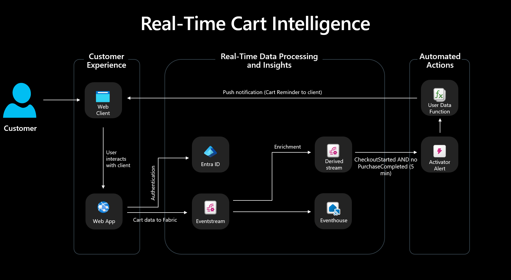

# 🛒 Cart Abandonment Real-Time Insights — Web Application

### ⚡ PowerShell Setup Button

   

---

A working reference implementation for turning live storefront behavior into real-time action, this project pairs a lightweight HTML and JavaScript e-commerce site with a streaming pipeline that carries cart events into Microsoft Fabric. Every browse, add-to-cart, checkout start, and abandonment is captured as it happens and published through an eventstream, giving downstream analytics and automation a continuous view of the customer journey. Push notifications close the loop, letting the solution respond to a wavering shopper while the session is still open. The result is a complete, end-to-end pattern for cart abandonment intelligence that teams can run, extend, and adapt to their own retail scenarios.

## ✅ Before You Start

- Windows 10 or Windows 11
- PowerShell 5.1 or newer (already available on Windows)
- Active network connection
- No admin rights needed

## Features

- **Real-Time Cart Event Capture** — Every browse, add-to-cart, checkout start, and abandonment signal is captured at the moment it happens and streamed instantly, so the business can act while the customer journey is still live.

- **Built-In Shopping Simulator** — Generate single events, batches of five or twenty, or a complete end-to-end customer journey with one click. Perfect for demos, testing, and validating the pipeline without manual browsing.

- **Microsoft Fabric Eventstream Integration** — Cart events flow directly into an eventstream, giving you a clean, scalable path from storefront interaction to downstream analytics and automation.

- **Push Notification Delivery** — Cart abandonment signals trigger push notifications, enabling timely, personalized re-engagement before the opportunity is lost.

- **Resilient Event Publishing** — Browser-side retry logic and an offline queue ensure events aren't lost to flaky connections, so your abandonment signals stay complete and reliable.

- **Multi-Page Storefront Experience** — A polished, realistic retail journey across product browsing, cart management, and checkout — designed to mirror authentic customer behavior and produce meaningful event data.

- **Secure by Design** — Event publishing uses Entra ID authentication, keeping credentials out of the browser and your streaming endpoint protected.

- **End-to-End Real-Time Intelligence Story** — From storefront click to dashboard insight, the project demonstrates the full arc: capture, stream, detect, enrich, store, and visualize — ready to demo and ready to extend.

- **Documentation-First Architecture** — Clear system-level guidance covers provisioning, validation, and component responsibilities, so teams can stand up the complete Fabric and Azure solution with confidence.

## Tech Stack

Every layer of this solution is built on a modern, production-ready foundation that keeps the storefront fast, the event pipeline reliable, and the analytics story clear.

**Storefront experience** — The customer-facing site is crafted with clean HTML and vanilla JavaScript, delivering a lightweight, dependency-free browsing and cart experience that loads instantly and stays out of the way of the shopping journey.

**Application backend** — An Express server on Node.js anchors the integration layer, validating incoming cart and checkout events and publishing them securely to an Event Hub-compatible endpoint using the Azure Event Hubs SDK with Entra ID authentication.

**Real-time ingestion** — Microsoft Fabric Eventstream powers the streaming backbone, exposing an Event Hub-compatible namespace that the app publishes to and routing the event flow toward downstream processing without custom plumbing.

**Intelligence and analytics** — Fabric's real-time intelligence capabilities complete the picture: Activator detects the moments that matter and triggers actions, a user data function handles enrichment, and Eventhouse stores the resulting signals for fast, queryable analysis and dashboard visualization.

**Resilience by design** — Browser-side retry logic, an offline event queue, a built-in simulator for generating realistic shopping journeys, and push notification support ensure events are never lost and demos always run smoothly.

Together, these choices keep the stack intentionally lean on the front end and fully managed on the back end — so the focus stays on the customer journey and the real-time insights it unlocks.

## FAQ

**What exactly does this project demonstrate?**
It shows how a modern storefront can capture shopping journey signals — product views, cart adds, checkout starts, and abandoned sessions — and stream them into Microsoft Fabric through an eventstream in real time. The app is the capture and publishing layer; Fabric handles the intelligence layer.

**Do I need a full Fabric environment to try it out?**
You can explore the storefront, cart flows, simulator mode, and notification behavior independently. To see events flow end to end, you will need an eventstream-compatible endpoint provisioned in your Fabric environment and the corresponding connection details configured in the app.

**How are cart abandonment signals actually detected?**
The storefront emits a sequence of journey events as the customer moves through the experience. When a checkout starts but no purchase event follows within the expected window, the session is treated as abandoned. Those raw signals are forwarded downstream so Fabric can evaluate, enrich, and act on them.

**What makes this different from a typical analytics demo?**
Most demos batch things up after the fact. This one is built around real-time intelligence — events leave the browser as they happen, flow through the backend with Entra ID authentication, and land in the streaming pipeline while the customer journey is still actionable.

**What happens if the network drops mid-session?**
The browser-side layer includes retry logic and an offline queue, so journey events are buffered and replayed rather than lost. This keeps the abandonment picture accurate even on flaky connections.

**Can I generate realistic traffic without clicking through the store manually?**
Yes. Simulator mode offers one-click event generation and full journey simulation, letting you exercise the pipeline and downstream Fabric components with realistic sequences in seconds.

**Are push notifications part of the abandonment flow?**
They are. The app includes push notification support, so abandonment scenarios can trigger customer-facing re-engagement rather than stopping at an alert on a dashboard.

**Is this production-ready or a learning vehicle?**
It is a polished, end-to-end reference implementation built for demos, experimentation, and architectural validation. The patterns — event capture, authenticated publishing, offline resilience, and downstream automation — are designed to carry over into real deployments.

**Where does the storefront end and Fabric begin?**
The website and backend API are implemented here and handle capture, validation, and publishing. Everything beyond that — eventstream routing, activator-driven alerts, eventhouse storage, and real-time dashboards — is where Fabric takes over. The documentation walks through that full architecture.

## License

This project is released under the MIT License, giving you the freedom to use, adapt, and build on it for both personal and commercial purposes. Whether you are exploring real-time cart abandonment scenarios, extending the storefront, or integrating the event pipeline into your own solution, the permissive licensing keeps the path open with minimal friction. The software is provided as-is, without warranties of any kind, and we encourage you to review the full license terms in the repository before distributing derivative work.